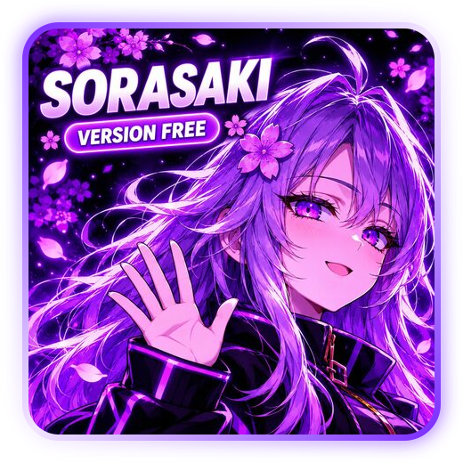

<p align="center">
  
</p>

<p align="center">
  
</p>



### 💜 Conheça a Sorasaki

Bot de WhatsApp simples, leve e fácil de editar para administrar grupos.
Feito por **IVAD**, desenvolvedor oficial da Sorasaki.

- 🛡️ Administração completa do grupo
- 🎬 Brincadeiras com GIF
- 🤝 Parcerias e lista negra
- 🎮 RPG completo com cassino e bolsa
- 💎 Aluguel com Pix (opcional)
- 🎨 Tudo personalizável pelo dono
- 📱 Termux, PC (Windows), Square Cloud e VPS

<br clear="right">

<p align="center">
  
  
  
  
</p>

<p align="center">
  <a href="https://whatsapp.com/channel/0029VbDgYzOL2AU7jRJrN304"></a>
</p>

<p align="center"></p>

## ✨ O que ela faz

| 🛡️ Administração | 🎉 Brincadeiras | 👑 Dono |
|---|---|---|
| ban, add, promover, rebaixar | ship, rank, sorteio | nome, prefixo e rodapé |
| abrir e fechar grupo | dado, moeda, chance | foto do menu e do bot |
| antilink e antipalavrão | piada, verdade, desafio | **todas as mensagens editáveis** |
| bem-vindo com foto e saída | termômetros (gado, chato...) | botões liga/desliga |
| advertências (3 = ban) | interações com GIF (beijo, abraço, soco, chute...) | transmissão, entrar e sair |
| marcar todos, hidetag, apagar | pergunta (8ball) | donos extras |
| link, nome e descrição do grupo | | reiniciar |
| parcerias (links liberados por dia) | | aluguel e Pix pelo Mercado Pago |
| lista negra (remove ao entrar) | | |

### 🎮 RPG completo
Economia, diário, trabalho, crime, banco, roubo, empréstimos, cassino com 15 jogos, bolsa de ações, poupança e CDB, propriedades e caixas misteriosas, coletas (pescar, minerar, caçar), missões, desafios, níveis, rankings, molduras, títulos, conquistas, VIP, enquetes e jogos (forca, quiz, anagrama, velha...).

```
#modorpg 1       → liga o RPG no grupo
#menurpg         → menu do RPG
#rpgconfig       → liga/desliga cada parte
#modojogos 1/0   → jogos do grupo
#menudonojogos   → controle total do dono
```

#### 🆕 Novidades do RPG
| | |
|---|---|
| 🏛️ **Banco Central** | Cartão com limite, crédito na hora, fatura com juros e nome sujo para quem não paga |
| 🕶️ **Mercado negro** | Faca, arma e bomba para o assalto ao Banco Central |
| 👮 **Carreiras** | Polícia, juiz e BOPE: prender, condenar, soltar e abater procurados |
| ⛓️ **Prisão e fiança** | Quem comete crime vira procurado; preso fica 15 min ou paga a fiança |
| 🌆 **Impérios e terrenos** | 15 impérios e 7 terrenos novos, com renda por dia |
| 💎 **Rank justo** | O rank dos mais ricos conta só o dinheiro na mão |
| ⏳ **Descansos** | Apostas a cada 10 s, brincadeiras a cada 20 s e 20 min de descanso nas carreiras |

```
#bancocentral    → cartão, crédito e fatura
#mercadonegro    → itens para o assalto
#carreiras       → polícia, juiz e BOPE
#procurados      → quem está procurado ou preso
```

- 🔘 Menus com **botões** (se o WhatsApp não mostrar, ela manda em texto)
- 🔑 Sem API, sem chave, sem nada pago: funciona sozinha
- 📱 Conecta por **código de pareamento** ou **QR Code**

<p align="center"></p>

## 📦 Instalação

### 📱 Termux
```bash
pkg update && pkg upgrade -y
pkg install nodejs git -y
git clone https://github.com/IVADCREATOR/Sorasaki-free
cd Sorasaki-free
npm install
npm start
```
Digite o número do bot (com 55 e DDD) e use o código que aparecer em
**WhatsApp › Aparelhos conectados › Conectar com número de telefone**.

### ☁️ Square Cloud
1. Coloque o número do bot em `numeroBot` no `config.json`
2. Compacte a pasta (sem `node_modules`) e envie, ou conecte o repositório
3. O código de pareamento aparece no **console**

O `squarecloud.app` já vem pronto.

### 💻 PC (Windows)
1. Instale o **Node.js 20 LTS** em [nodejs.org](https://nodejs.org) (Next, Next, Concluir).
2. Instale o **Git** em [git-scm.com](https://git-scm.com/download/win).
3. Abra o **Prompt de Comando** (tecla Windows, digite `cmd`) e rode:
```bash
git clone https://github.com/IVADCREATOR/Sorasaki-free
cd Sorasaki-free
npm install
npm start
```
4. Digite o número do bot (com 55 e DDD) e use o código em **WhatsApp › Aparelhos conectados**.

Sem Git: baixe pelo botão **Code › Download ZIP**, extraia, abra a pasta, digite `cmd` na barra de endereço e rode `npm install` e `npm start`.
Use o **Prompt de Comando (cmd)**, não o PowerShell. Se aparecer `npm.ps1 não pode ser carregado`, use `npm.cmd install` e `npm.cmd start`, ou rode uma vez no PowerShell: `Set-ExecutionPolicy -Scope CurrentUser RemoteSigned` (responda `S`).
Deixe o PC ligado e sem hibernar enquanto a bot estiver rodando. Para religar: abra o `cmd` na pasta e rode `npm start`.

### 🖥️ Bronxys, Discloud ou qualquer VPS
- Arquivo principal: `index.js`
- Comando de início: `npm start`
- Node.js **20 ou superior**
- Coloque o número em `numeroBot` no `config.json` para receber o código no console

<p align="center"></p>

## 🔄 Atualização

Suas configurações, sessão e dados ficam salvos: atualizar **não apaga nada**.

### 📱 Termux, 💻 PC, 🖥️ VPS e Bronxys (pelo console)
Pare a bot e rode dentro da pasta dela:
```bash
npm run atualizar
npm start
```
<sub>É o mesmo que `git pull --autostash origin main && npm install`.</sub>

Se você instalou baixando o zip (sem `git clone`), faça uma vez:
```bash
git init
git remote add origin https://github.com/IVADCREATOR/Sorasaki-free
git fetch origin
git reset --mixed origin/main
git branch -M main
git checkout -- src vendor assets index.js package.json README.md
```
Depois disso, é só usar o `npm run atualizar`.

### ☁️ Square Cloud
1. Faça um **Fork** deste repositório na sua conta do GitHub.
2. Na Square Cloud, conecte a aplicação ao seu fork e ligue o deploy automático.
3. Quando sair atualização, abra o seu fork e clique em **Sync fork › Update branch**.
4. A Square Cloud atualiza sozinha. Se não atualizar, clique em **Reiniciar**.

### 🖥️ Painéis com Git (Bronxys, Pterodactyl e parecidos)
Se o painel tiver os campos **Git Repo Address** e **Auto Update**:
- Git Repo Address: `https://github.com/IVADCREATOR/Sorasaki-free`
- Auto Update: **ligado**

Assim ela atualiza sozinha toda vez que reiniciar.

📢 Os avisos de atualização saem no [canal da Sorasaki](https://whatsapp.com/channel/0029VbDgYzOL2AU7jRJrN304).

<p align="center"></p>

## ⚙️ Configuração

Edite o `config.json` antes de ligar:

```json
{
  "nomeBot": "Sorasaki",
  "prefixo": "#",
  "nomeDono": "IVAD",
  "dono": ["5511999999999"],
  "numeroBot": "",
  "botoes": true,
  "rodape": "Sorasaki · version free",
  "maxAdv": 3
}
```

Depois de ligada, quase tudo dá pra mudar pelo próprio WhatsApp com os comandos de dono (`#menudono`).

### 🔣 Prefixo
```
#mudarprefixo !               → troca o prefixo principal
#multiprefixo 1               → aceita vários prefixos ao mesmo tempo (# ! . /)
#addprefixo ?  ·  #rmprefixo ? → adiciona ou tira um prefixo extra
#prefixos                     → mostra os prefixos
```
Esqueceu o prefixo? Mande só `prefixo` que a bot responde.

### 📝 Mudando as mensagens
```
#msgs                         → lista todas as mensagens
#setmsg ativado 🟢 Ligado!    → troca uma mensagem
#resetmsg ativado             → volta ao padrão
```

### 💎 Aluguel (opcional)
Vem **desligado**: a bot funciona em qualquer grupo. Se quiser cobrar:
```
#modoaluguel 1                → só grupos com aluguel funcionam
#addplano 30 15               → plano de 30 dias por R$ 15
#addaluguel 30                → libera o grupo na mão (use dentro dele)
#savegp                       → salva o grupo como permanente
#alugueis                     → lista os grupos e vencimentos
```
Os membros veem os planos com `#planos` e o tempo restante com `#aluguel`. A bot avisa 1 dia antes de vencer e quando vence.

### 💳 Mercado Pago (opcional)
Para o grupo ser liberado sozinho por Pix:
1. Pegue o **Access Token de produção** em mercadopago.com.br/developers → Suas integrações → Credenciais.
2. Mande no **privado** da bot: `#setmp SEU_TOKEN`
3. Pronto: `#alugar 30` gera o QR Code e o copia e cola, e o grupo é liberado assim que o pagamento cair.

O token fica salvo só na pasta `data/`, que não vai para o GitHub. Para tirar: `#rmmp`.

<p align="center"></p>

## 🧩 Criando um comando

Abra um arquivo em `src/comandos/` e adicione na lista:

```js
{
  nomes: ["oi", "ola"],
  categoria: "geral",
  run: async (c) => c.reply(`Oi, @${c.autorNum}!`, [c.autor]),
}
```

Opções: `grupo: true` (só grupo), `admin: true` (só ADM), `dono: true` (só dono),
`botAdmin: true` (bot precisa ser ADM), `desc: "texto"` (aparece no menu).
O comando entra no menu sozinho, pela `categoria`.

<p align="center"></p>

## 📁 Estrutura

```
index.js            → liga o bot
config.json         → configuração
src/conexao.js      → conexão com o WhatsApp
src/mensagens.js    → lê as mensagens e chama os comandos
src/eventos.js      → bem-vindo e saída
src/comandos/       → todos os comandos (um arquivo por categoria)
src/lib/            → mensagens, banco de dados, botões
assets/menu.jpg     → foto padrão do menu
data/               → criado sozinho (dados dos grupos)
sessao/             → criado sozinho (login do WhatsApp, não compartilhe!)
```

<p align="center"></p>

## 💜 Quer a Sorasaki completa?

A versão completa tem **IA que conversa com o grupo**, **antigolpe**, triagem de quem entra,
cartão de boas-vindas com foto e muito mais.

👉 **[Alugue a Sorasaki no WhatsApp](https://wa.me/5511941763807?text=%23alugar)**

<p align="center"></p>

<p align="center"></p>
